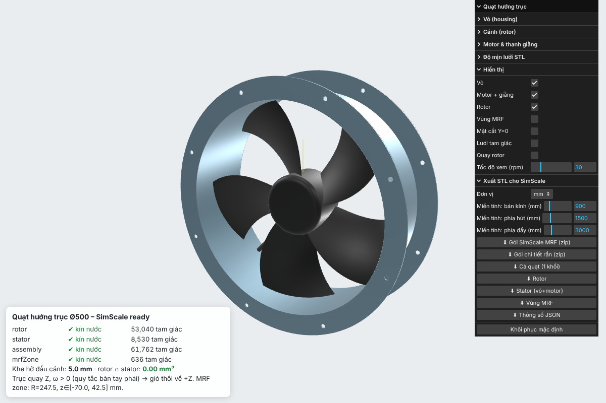

# Quạt hướng trục Ø500 – mô hình Three.js tham số, xuất STL cho SimScale



Mô hình 3D tham số của quạt hướng trục lắp bích (vỏ ống + 2 mặt bích có lỗ bulông, motor rotor ngoài, 5 cánh dạng lưỡi liềm, 4 thanh giằng, hộp điện).

- **Dựng hình:** [manifold-3d](https://github.com/elalish/manifold). Mọi khối xuất ra đều kín nước (watertight), đóng, pháp tuyến hướng ra ngoài và không tự cắt. Đây là điều kiện để SimScale chia lưới được.
- **Xem và chỉnh:** Three.js (`index.html`). Sửa thông số trong bảng điều khiển thì hình dựng lại ngay, và có thể xuất STL/ZIP trực tiếp từ trình duyệt.
- **Xuất hàng loạt:** `npm run export` dựng hình, kiểm tra và ghi file vào `export/`.

> Kích thước mặc định là ước lượng theo ảnh của một quạt Ø500 điển hình, **không phải số đo của sản phẩm cụ thể**. Nếu có datasheet, hãy nhập lại các thông số ở phần [Thông số](#thông-số).

## File có sẵn trong `export/` (đơn vị **mm**)

| File | Nội dung | Dùng khi |
|---|---|---|
| **`simscale_mrf_mm.zip`** | 2 vùng **lưu chất** dựng sẵn: `flow_static` (miền tĩnh) và `flow_rotating` (vùng MRF), mặt đã đặt tên | **Khuyên dùng** cho mô phỏng quạt bằng MRF |
| `simscale_parts_mm.zip` | 3 khối **rắn**: `rotor`, `stator`, `mrf_zone` | Khi muốn tự tạo miền lưu chất trong SimScale |
| `fan_assembly.stl` | Cả quạt là 1 khối rắn (rotor nối stator qua trục) | Mô phỏng nhanh không quay, xem cản dòng |
| `fan_rotor.stl` / `fan_stator.stl` / `fan_mrf_zone.stl` | Từng chi tiết, binary STL | Dùng trong phần mềm CAD/CFD khác |
| `report.json` | Kết quả kiểm tra: kín nước, thể tích, genus, bbox, khe hở | Đối chiếu |

**Hệ trục:** trục quay là **Z** đi qua gốc (0,0,0), mặt phẳng giữa cánh nằm ở z = 0. Khi **ω > 0 quanh +Z** (quy tắc bàn tay phải), gió thổi về **+Z**: phía hút ở −Z, phía đẩy ở +Z.

### Gói `simscale_mrf_mm.zip`

SimScale nhận một ZIP gồm nhiều STL như sau: **mỗi file STL thành 1 solid (khối)**, và **mỗi khối `solid <tên>` trong file thành 1 mặt có tên**.

| Khối | Các mặt |
|---|---|
| `flow_static` = miền tính − stator − trụ MRF | `inlet` (z = −1500), `outlet` (z = +3000), `farfield` (vỏ trụ R = 900), `stator_walls`, `mrf_interface` |
| `flow_rotating` = trụ MRF − rotor | `rotor_walls`, `mrf_interface` |

Hai khối dùng chung **đúng cùng một bộ tam giác** cho `mrf_interface` (mặt tiếp giáp trùng khớp). Script kiểm tra điều này mỗi lần xuất.

Vùng MRF là hình trụ R = 247.5 mm, z ∈ [−70, 42.5] mm. Mặt trụ nằm giữa khe hở đầu cánh (cánh R = 245, vỏ R = 250), mặt sau nằm giữa khe rotor–stator (40 → 45 mm).

## Quy trình trên SimScale (Incompressible + MRF)

1. **Upload:** *Geometries → Import* rồi chọn `simscale_mrf_mm.zip`.
   - Đơn vị: **mm**. STL không lưu đơn vị nên phải chọn khi upload. Nếu muốn dùng mét, chạy `npm run export:m`.
   - **Tắt "Facet split"** để mỗi `solid` giữ nguyên là một mặt có tên.
   - Sau khi upload, kiểm tra trong cây hình học có 2 khối và các mặt mang tên như bảng trên.
2. **Tạo simulation:** *Incompressible*, *Steady-state*, turbulence **k-ω SST**, chọn **Internal flow** và vật liệu **Air**.
3. **Advanced concepts → Rotating zones → MRF rotating zone**
   - Gán **volume `flow_rotating`**. MRF bắt buộc gán khối, không gán mặt.
   - Origin `(0, 0, 0)`, axis `(0, 0, 1)`.
   - Rotational velocity, ví dụ 1400 rpm ≈ **146.6 rad/s**. Giá trị dương thì gió thổi về +Z.
4. **Boundary conditions**
   - `inlet`: *Pressure inlet*, total pressure 0 Pa.
   - `outlet`: *Pressure outlet*, static pressure 0 Pa. Để dựng **đường đặc tính quạt**, chạy lại nhiều lần với áp ra Δp = 0, 50, 100… Pa.
   - `farfield`: *Wall (slip)* để mô phỏng buồng thử. Nếu muốn mô phỏng quạt đặt trong không gian rộng, đặt *Pressure inlet* 0 Pa.
   - `rotor_walls`, `stator_walls`: *Wall, no-slip* (mặc định). Rotor tự quay theo vùng MRF.
5. **Mesh:** *Standard*, độ mịn khoảng 6–7, thêm các refinement sau:
   - *Region refinement* cho khối `flow_rotating`: khoảng 4 mm.
   - *Surface refinement* cho `rotor_walls`: khoảng 1.5–2 mm.
   - Phải có **ít nhất 3–4 ô trong khe đầu cánh 5 mm**, tức cỡ ô ≤ 1–1.25 mm quanh R = 245–250. Có thể tạo một *region refinement* hình trụ rỗng bằng *Geometry primitive*.
   - *Inflation layers* 3–5 lớp trên `rotor_walls`.
6. **Result control:** thêm *Area average* / *Flow rate* trên `outlet` để lấy lưu lượng, và *Forces and moments* trên `rotor_walls` (tâm (0,0,0)). Công suất trục P = M_z · ω, hiệu suất η = Q·Δp / P.

Nếu dùng gói `simscale_parts_mm.zip`, upload rồi mở **CAD mode** để tạo flow volume (*Internal/External flow volume*), sau đó lấy `mrf_zone` làm vùng quay. Lưu ý: CAD mode của SimScale hỗ trợ hình dạng dạng lưới (STL) hạn chế hơn so với STEP, nên gói MRF ở trên là cách ổn định hơn.

## Chạy

```bash
npm install
npm run export            # → export/  (mm)
npm run export:m          # → export/m (mét)
node scripts/export.mjs --bladeCount 7 --sweepDeg 0 --domainRadius 1200   # đổi thông số bất kỳ
npm run serve             # rồi mở http://localhost:3000 để xem Three.js
```

Trang xem tải `three`, `lil-gui` và `manifold-3d` từ CDN jsDelivr, nên cần có mạng và cần mở qua HTTP server (không mở trực tiếp file://). Bảng điều khiển gồm:

- Chỉnh thông số vỏ, cánh, motor và độ mịn lưới.
- Bật/tắt vỏ, rotor, vùng MRF; xem mặt cắt Y = 0, lưới tam giác, quay rotor.
- Xuất gói SimScale, từng chi tiết và JSON thông số (đơn vị mm hoặc m).

Góc dưới trái hiển thị kết quả kiểm tra kín nước và giao cắt rotor–stator.

`npm run export` sẽ **thoát với mã lỗi** nếu có bất kỳ kiểm tra nào trượt:

- Từng khối là manifold hợp lệ.
- File STL đọc lại vẫn kín nước sau khi gộp đỉnh theo toạ độ.
- Rotor và stator không giao nhau.
- Rotor nằm trọn trong vùng MRF, và vùng MRF không chạm stator.
- Mỗi vùng lưu chất là đúng 1 khối liên thông.
- `mrf_interface` trùng khớp giữa hai vùng.

## Thông số

Tất cả nằm trong `DEFAULTS` (`src/fan.js`) và `DOMAIN_DEFAULTS` (`src/simscale.js`), đơn vị mm và độ.

| Nhóm | Thông số mặc định |
|---|---|
| Vỏ | Ø trong 500, dày 2, dài 180; bích Ø600 dày 3; 8 lỗ Ø10 trên vòng Ø560; có hộp điện |
| Rotor | 5 cánh, khe hở đầu cánh 5; bầu Ø144 dài 90; dây cung 95 → 185; góc đặt 40° → 20°; vuốt −15°; dày 3 (mỏng dần 30% ra đầu cánh); độ cong 5% |
| Stator | motor sau Ø110 dài 40, khe rotor–stator 5; 4 thanh giằng Ø12 |
| Miền tính | R = 900, phía hút 1500, phía đẩy 3000 |
| Lưới | 160 đoạn/vòng tròn; mỗi cánh 48 × 48 đoạn (dày hơn ở mép và đầu cánh) |

Mỗi tiết diện cánh là một tấm cong (camber dạng parabol, mép tròn tù), được **cuộn lên mặt trụ r = const**. Nhờ vậy đầu cánh là một mặt trụ đúng và khe hở đầu cánh đều trên toàn bộ dây cung.

## Cấu trúc

```
src/fan.js        dựng hình tham số (manifold-3d)
src/simscale.js   vùng lưu chất + gói ZIP cho SimScale
src/stl.js        ghi STL binary/ASCII nhiều solid, kiểm tra kín nước
src/zip.js        ghi ZIP (Node + trình duyệt)
src/viewer.js     trang xem Three.js
scripts/export.mjs  xuất + kiểm tra hàng loạt
```
